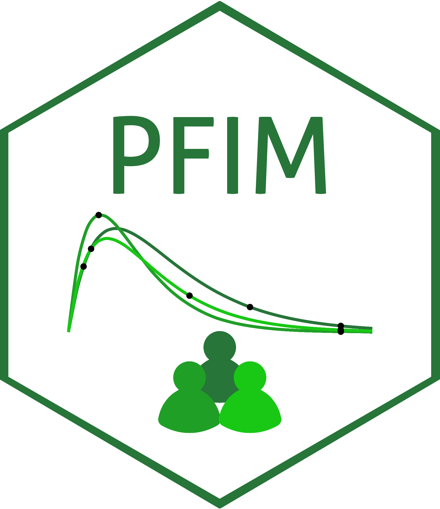

[](https://cran.r-project.org/package=PFIM)
[](https://cran.r-project.org/package=PFIM)
[](https://www.gnu.org/licenses/gpl-3.0)

# PFIM 

### Overview

PFIM is an R package for evaluating and optimizing designs for nonlinear mixed-effects models using the **Fisher information matrix**. It provides tools for population pharmacokinetic / pharmacodynamic (PK/PD) and related clinical study design.

**PFIM 8.0.1** reimplements the package on **S7**, with **C++** kernels (Rcpp / Armadillo) for FIMs and optimizers. The user workflow centres on **`run()`**, **`Report()`**, constructors such as **`Evaluation()`** / **`Optimization()`**, and **`get*()` / `plot*()`** accessors.

**Key features**

- **User workflow**: concise scripts built from S7 objects (`Arm`, `Design`, `ModelParameter`, sampling and error models)
- **Model library**: pre-built PK/PD models (bolus, infusion, absorption, 1–2 compartments, turnover, Michaelis–Menten, PK/PD couples)
- **Custom models**: user-defined **analytic** or **ODE** models; algebraic **`outputs`** (e.g. concentration from amounts)
- **FIM types**: population, individual, and Bayesian FIM; **covariates** and **inter-occasion variability (IOV)**
- **Covariate tests**: `covariateTest()` / `tost()` for statistical and clinical relevance of covariate effects
- **Optimization**: discrete (**Fedorov–Wynn**, **multiplicative**) and continuous (**Simplex**, **PSO**, **PGBO**) with sampling **windows**
- **Residual error**: `Constant`, `Proportional`, `Combined1`, `Combined2` (parameters on the **SD** scale)

The source code is modular (**purrr**-style helpers and **S7** classes), which makes it easier to extend models and algorithms.

> **Note:** PFIM **7.x** releases are **deprecated** and no longer maintained. Current release: **8.0.1** (maintenance: ODE test tolerance on macOS). See [`NEWS.md`](NEWS.md) for breaking changes and migration from version 7.  
> Requires **R ≥ 4.5.0** and a **C++17** toolchain for source builds.

### Installation

```r
# Install from CRAN:
install.packages("PFIM")

# Load the package:
library(PFIM)
```

### Quick start — vignettes

Structured tutorials ship with the package:

```r
vignette("Vignette_01_discrete_design")           # evaluation + discrete optimization
vignette("Vignette_02_continuous_design")         # continuous sampling times
vignette("Vignette_03_covariates_analytical_pk")  # covariates & IOV
vignette("Vignette_04_tim_waterhouse_pediatric")  # sparse pediatric design (PopED)
vignette("Vignette_05_gcse_pkpd")                 # G-CSF PK/PD ODE (PopED check)
vignette("LibraryOfModels")                       # model catalogue
```

| Vignette | Topic |
|---|---|
| `Vignette_01_discrete_design` | PK/PD ODE example; population FIM; **Fedorov–Wynn** and **multiplicative** optimization on a discrete grid |
| `Vignette_02_continuous_design` | Library PK (infusion); **PSO**, **PGBO**, **Simplex** under time windows |
| `Vignette_03_covariates_analytical_pk` | Analytic PK; categorical covariates; **IOV**; covariate tests |
| `Vignette_04_tim_waterhouse_pediatric` | Sparse oral PK; pediatric weight; alignment with PopED / Tim Waterhouse material |
| `Vignette_05_gcse_pkpd` | Filgrastim PK/PD ODE; PopED Design 1; residual error (`Combined2`) |
| `LibraryOfModels` | Built-in PK/PD models (bolus, infusion, steady state, PK/PD, ODE) |

Covariates and IOV in discrete / continuous designs are covered in **8.0.1** — especially **`Vignette_03`** and the [`NEWS.md`](NEWS.md) entry for `covariateTest()`.

Session options: `?pfim_set_option` (FIM cache, constraint grids, performance).

### Methodology

The methods implemented in PFIM are based on established research in optimal design theory:

- Mentré F, Mallet A, Baccar D (1997) <doi:10.1093/biomet/84.2.429>
- Retout S, Comets E, Samson A, Mentré F (2007) <doi:10.1002/sim.2910>
- Bazzoli C, Retout S, Mentré F (2009) <doi:10.1002/sim.3573>
- Le Nagard H, Chao L, Tenaillon O (2011) <doi:10.1186/1471-2148-11-326>
- Combes FP, Retout S, Frey N, Mentré F (2013) <doi:10.1007/s11095-013-1079-3>
- Seurat J, Tang Y, Mentré F, Nguyen TT (2021) <doi:10.1016/j.cmpb.2021.106126>

### Package information

| Field | Details |
|---|---|
| **Version** | 8.0.1 |
| **License** | GPL-3 \| file LICENSE |
| **Author** | Romain Leroux — [romain.leroux@inserm.fr](mailto:romain.leroux@inserm.fr) |
| **Maintainer** | France Mentré — [pfim@inserm.fr](mailto:pfim@inserm.fr) |
| **Repository** | [github.com/iame-researchCenter/PFIM](https://github.com/iame-researchCenter/PFIM) |
| **Website** | [pfim.biostat.fr](https://www.pfim.biostat.fr/) |

**Authors and contributors**

- **Romain Leroux** — [ORCID 0009-0009-5779-5303](https://orcid.org/0009-0009-5779-5303) · `[aut]` · PFIM 8.0 source code · romain.leroux@inserm.fr  
- **France Mentré** — [ORCID 0000-0002-7045-1275](https://orcid.org/0000-0002-7045-1275) · `[cre]` · pfim@inserm.fr  
- **Lucie Fayette** — [ORCID 0009-0001-0048-5998](https://orcid.org/0009-0001-0048-5998) · `[ctb]` · logo design  
- **Antoine Croxo** — [ORCID 0009-0007-4726-5259](https://orcid.org/0009-0007-4726-5259) · `[ctb]`  
- **Jérémy Seurat** — [ORCID 0000-0002-8127-7751](https://orcid.org/0000-0002-8127-7751) · `[ctb]`

### Repository structure

The CRAN source package is organised as follows. Legacy **`Design_Evaluation/`** and **`Design_Optimization/`** script folders from PFIM 7 are replaced by **vignettes**, **`inst/vignette-scripts/`**, and **`inst/examples/`**.

#### S7 classes and code — `R/` and `src/`

- **`R/`**: S7 classes (`Evaluation`, `Optimization`, `Model*`, FIM types, optimizers, covariates, error models), **`run()`**, **`Report()`**, model library  
- **`src/`**: C++ FIM, gradients, and optimization kernels  

#### Design evaluation and optimization

| Use case | Where to look in PFIM 8.0.1 |
|---|---|
| Library PK/PD evaluation | `vignette("LibraryOfModels")`; `definePKModel()` / `definePKPDModel()` |
| User ODE / analytic models | `Vignette_01`; custom `modelEquations` in `Evaluation()` / `Optimization()` |
| Infusion, steady state, PK/PD couples | `LibraryOfModels` + help pages for library model names |
| **Continuous** optimization (windows) | `Vignette_02` — **PGBO**, **PSO**, **Simplex** |
| **Discrete** optimization (times / doses) | `Vignette_01` — **Fedorov–Wynn**, **multiplicative** |
| Covariates & IOV | `Vignette_03` |
| PopED benchmarks | `Vignette_04`, `Vignette_05` |

**Continuous** optimizers search sampling times inside user-defined **windows** (`samplingsWindows`, `numberOfTimesByWindows`, minimum intervals).

**Discrete** optimizers search on grids of candidate **times** and optionally **doses** (`administrationsConstraints`, `samplingTimesConstraints`).

| Algorithm | Type | Role |
|---|---|---|
| **PGBO** | Continuous | Population genetics–based search |
| **PSO** | Continuous | Particle swarm |
| **Simplex** | Continuous | Nelder–Mead on sampling times |
| **Fedorov–Wynn** | Discrete | Point-exchange on candidate protocols |
| **Multiplicative** | Discrete | Weight update on candidate arms |

#### Vignettes — `vignettes/`

R Markdown sources built to HTML in **`inst/doc/`** for CRAN. See the table in [Quick start](#quick-start--vignettes).

#### Documentation — `man/`

Roxygen-generated **`.Rd`** help (`?PFIM`, `?run`, class and method pages). HTML **reports** from `Report()` need **rmarkdown** and **pandoc**.

#### Unit tests — `tests/testthat/`

- Analytic and ODE FIM regression tests  
- Optimizer and covariate branches  
- PopED G-CSF Design 1 RSE check (`Vignette_05` script)  

#### Cached vignette results — `inst/vignette-data/`, `vignettes/data/`

Precomputed `.RDS` files so `R CMD check` can build vignettes without re-running long optimizations.

### Getting help

**Bugs:** open an issue with a **minimal reproducible example** in [PFIM Issues](https://github.com/iame-researchCenter/PFIM/issues). Include PFIM and R versions (`packageVersion("PFIM")`, `R.version.string`), a short script, and the full error or unexpected output.

**Questions, methods, feature ideas:** [PFIM Discussions](https://github.com/iame-researchCenter/PFIM/discussions) on GitHub.
